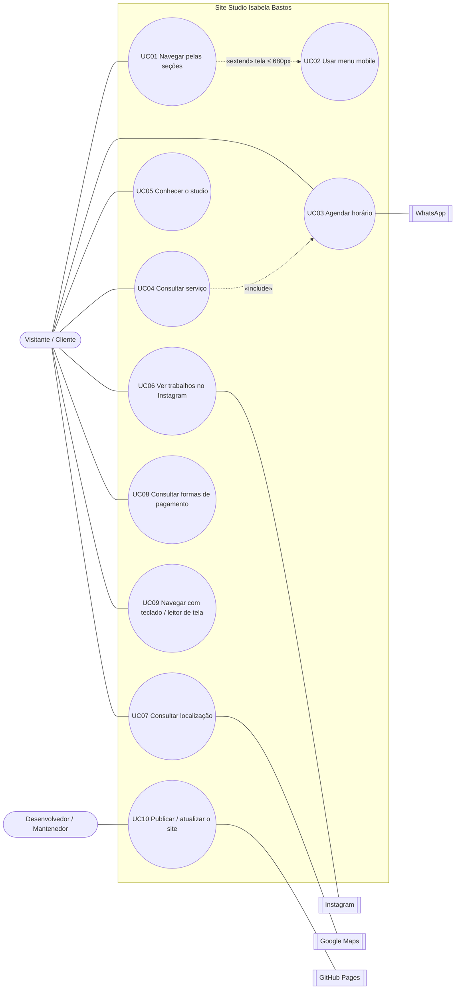

# Casos de Uso — Site Studio Isabela Bastos

| Item | Descrição |
|---|---|
| Projeto | Site institucional do Studio Isabela Bastos |
| Documento relacionado | `01-levantamento-de-requisitos.md` |
| Versão do documento | 1.0 |
| Data | 12/10/2026 |

---

## 1. Atores

| Ator | Tipo | Descrição |
|---|---|---|
| Visitante / Cliente | Principal | Pessoa que acessa o site para conhecer o studio e agendar um horário. |
| Proprietária | Secundário | Recebe os contatos pelo WhatsApp e fornece conteúdo (fotos, endereço, pagamento). |
| Desenvolvedor / Mantenedor | Principal (manutenção) | Publica e atualiza o site no GitHub Pages. |
| WhatsApp | Sistema externo | Canal de conversa e agendamento. |
| Instagram | Sistema externo | Portfólio de trabalhos do studio. |
| Google Maps | Sistema externo | Mapa incorporado e rotas. |
| GitHub Pages | Sistema externo | Hospedagem do site. |

---

## 2. Diagrama de casos de uso

---

## 3. Especificação dos casos de uso

### UC01 — Navegar pelas seções
| Campo | Descrição |
|---|---|
| Ator | Visitante |
| Requisitos | RF01, RNF03 |
| Pré-condição | Site carregado no navegador. |
| Pós-condição | A seção escolhida fica visível abaixo do cabeçalho fixo. |

**Fluxo principal**
1. O visitante clica em um item do menu (O studio, Experiência ou Localização).
2. O site rola suavemente até a seção correspondente.
3. O cabeçalho permanece fixo no topo.

**Fluxo alternativo**
- **A1 — Rolagem manual:** o visitante rola a página livremente; as seções aparecem em sequência.
- **A2 — Movimento reduzido:** se o sistema do usuário pede redução de movimento, a rolagem acontece sem animação.

---

### UC02 — Usar menu mobile
| Campo | Descrição |
|---|---|
| Ator | Visitante |
| Requisitos | RF02, RNF04 |
| Pré-condição | Tela com largura até 680px. |
| Pós-condição | Menu fechado e visitante na seção escolhida. |

**Fluxo principal**
1. O visitante toca no botão de menu (ícone de três linhas).
2. O menu se abre; o ícone vira um "X" e o rótulo acessível passa a "Fechar menu".
3. O visitante toca em um link.
4. O menu se fecha e a página rola até a seção.

**Fluxos alternativos**
- **A1 — Fechar sem navegar:** o visitante toca novamente no botão e o menu se fecha.
- **A2 — Tecla Esc:** com o menu aberto, ao pressionar Esc o menu se fecha e o foco volta ao botão.

---

### UC03 — Agendar horário
| Campo | Descrição |
|---|---|
| Ator | Visitante / Cliente |
| Sistema externo | WhatsApp |
| Requisitos | RF04, RF05, RN01, RN02, RNF06 |
| Pré-condição | Visitante com acesso ao WhatsApp (app ou web). |
| Pós-condição | Conversa aberta com o WhatsApp do studio. |

**Fluxo principal**
1. O visitante clica em um botão de agendamento ("Agende seu horário", "Agendar horário", "Fale com a Isabela" ou botão flutuante).
2. O site abre o link do WhatsApp em nova aba.
3. O WhatsApp abre a conversa com o studio.
4. O visitante envia a mensagem e combina data e horário diretamente com a proprietária.

**Fluxos alternativos**
- **A1 — Sem app no computador:** o WhatsApp oferece abrir pelo WhatsApp Web.
- **A2 — No celular:** o app do WhatsApp abre diretamente.

**Fluxo de exceção**
- **E1 — Link inválido ou desativado:** o WhatsApp exibe erro; o visitante pode recorrer ao Instagram (UC06). *Mitigação: o mantenedor deve testar o link periodicamente.*

---

### UC04 — Consultar serviço
| Campo | Descrição |
|---|---|
| Ator | Visitante |
| Requisitos | RF08 |
| Pré-condição | Visitante na seção "Experiência". |
| Pós-condição | Visitante informado e, se desejar, em conversa no WhatsApp. |

**Fluxo principal**
1. O visitante lê os cartões: Extensão de cílios, Atendimento personalizado e Agendamento pelo WhatsApp.
2. O visitante clica em "Consultar", "Fale com a Isabela" ou "Agendar horário".
3. Executa-se o **UC03 — Agendar horário** («include»).

---

### UC05 — Conhecer o studio
| Campo | Descrição |
|---|---|
| Ator | Visitante |
| Requisitos | RF06, RF07, RNF05 |
| Pré-condição | Visitante na seção "O studio". |
| Pós-condição | Visitante conhece o espaço e os diferenciais do atendimento. |

**Fluxo principal**
1. O visitante lê o texto de apresentação.
2. As fotos do espaço são carregadas conforme a rolagem.
3. O visitante visualiza a galeria (no desktop, a foto amplia levemente ao passar o mouse).
4. O visitante lê os três diferenciais do atendimento.

**Fluxo de exceção**
- **E1 — Imagem não carrega:** é exibido o texto alternativo e o fundo neutro do cartão. *Causa mais provável no GitHub Pages: diferença de maiúsculas/minúsculas no nome do arquivo.*

---

### UC06 — Ver trabalhos no Instagram
| Campo | Descrição |
|---|---|
| Ator | Visitante |
| Sistema externo | Instagram |
| Requisitos | RF12 |
| Pré-condição | Nenhuma. |
| Pós-condição | Perfil do studio aberto em nova aba. |

**Fluxo principal**
1. O visitante clica no @ do Instagram (barra superior, "Acompanhe nosso trabalho" ou rodapé).
2. O perfil do studio abre em nova aba.

---

### UC07 — Consultar localização
| Campo | Descrição |
|---|---|
| Ator | Visitante |
| Sistema externo | Google Maps |
| Requisitos | RF09, RF10 |
| Pré-condição | Visitante na seção "Localização". |
| Pós-condição | Visitante conhece o endereço e, se desejar, tem a rota aberta no Google Maps. |

**Fluxo principal**
1. O visitante lê o endereço exibido.
2. O visitante visualiza o mapa incorporado.
3. O visitante clica em "Ver no mapa".
4. O Google Maps abre em nova aba com o endereço pesquisado, permitindo traçar a rota.

**Fluxo de exceção**
- **E1 — Mapa bloqueado** (extensão de privacidade ou rede): o endereço em texto e o botão "Ver no mapa" continuam disponíveis.

---

### UC08 — Consultar formas de pagamento
| Campo | Descrição |
|---|---|
| Ator | Visitante |
| Requisitos | RF11, RN03, RN04 |
| Pré-condição | Visitante na seção de pagamento. |
| Pós-condição | Visitante ciente das formas de pagamento e do possível acréscimo no cartão. |

**Fluxo principal**
1. O visitante visualiza Pix, Dinheiro e Cartão (débito e crédito).
2. O visitante lê o aviso sobre o acréscimo da maquininha.
3. Se tiver dúvidas sobre valores, segue para o **UC03**.

---

### UC09 — Navegar com teclado / leitor de tela
| Campo | Descrição |
|---|---|
| Ator | Visitante com deficiência ou que prefere teclado |
| Requisitos | RNF04 |
| Pré-condição | Site carregado. |
| Pós-condição | Visitante consegue acessar todo o conteúdo e os botões sem mouse. |

**Fluxo principal**
1. Ao pressionar Tab, o primeiro item focado é "Pular para o conteúdo".
2. Ao ativá-lo, o foco vai para o conteúdo principal, pulando o menu.
3. O visitante percorre links e botões com Tab; cada elemento exibe contorno de foco.
4. O leitor de tela anuncia os rótulos acessíveis (ex.: "Agendar horário pelo WhatsApp") e os textos alternativos das fotos.

---

### UC10 — Publicar / atualizar o site
| Campo | Descrição |
|---|---|
| Ator | Desenvolvedor / Mantenedor |
| Sistema externo | GitHub Pages |
| Requisitos | RNF02, RNF12 |
| Pré-condição | Repositório no GitHub com acesso de escrita. |
| Pós-condição | Versão atualizada disponível no endereço público. |

**Fluxo principal**
1. O mantenedor altera os arquivos localmente (`index.html`, `styles.css`, `script.js`, `images/`).
2. Testa no navegador, em desktop e mobile (modo responsivo do DevTools).
3. Faz commit e push para a branch principal.
4. O GitHub Pages publica a nova versão automaticamente.
5. O mantenedor valida no endereço público os critérios de aceite do documento de requisitos.

**Fluxos de exceção**
- **E1 — Pages não configurado:** em *Settings → Pages*, selecionar *Deploy from a branch*, branch principal, pasta `/(root)`.
- **E2 — Imagens quebradas após publicar:** conferir se o nome e a extensão (`.PNG`) estão idênticos ao HTML.
- **E3 — Alteração não aparece:** aguardar alguns minutos ou limpar o cache do navegador.

---

## 4. Matriz de rastreabilidade (Caso de uso × Requisitos)

| Caso de uso | Requisitos relacionados |
|---|---|
| UC01 | RF01, RNF03 |
| UC02 | RF02, RNF04 |
| UC03 | RF04, RF05, RN01, RN02, RNF06 |
| UC04 | RF08 |
| UC05 | RF06, RF07, RNF05 |
| UC06 | RF12 |
| UC07 | RF09, RF10 |
| UC08 | RF11, RN03, RN04 |
| UC09 | RNF04 |
| UC10 | RNF02, RNF12 |
